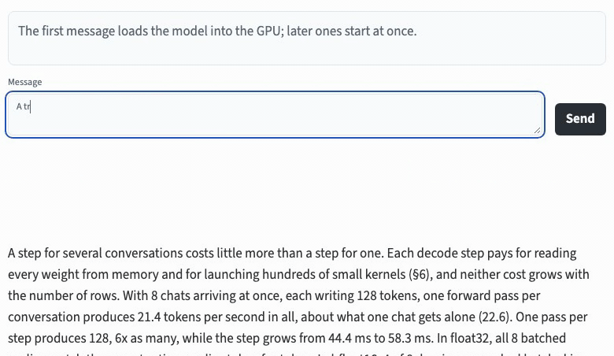

<div align="center">

<picture>
  <source media="(prefers-color-scheme: dark)" srcset="https://raw.githubusercontent.com/samitmohan/stackgrad/master/docs/logo_dark.svg">
  
</picture>

stackgrad: A deep learning framework written from scratch, up to a served Qwen3 with retrieval and a tool-using agent.

<h3>

[Homepage](https://github.com/samitmohan/stackgrad) | [Documentation](https://samitmohan.github.io/stackgrad/) | [Write-up](https://samitmohan.in/blog/minitorch) | [PyPI](https://pypi.org/project/stackgrad/)

</h3>

[](https://github.com/samitmohan/stackgrad/actions/workflows/ci.yml)
[](https://pypi.org/project/stackgrad/)

</div>

---



stackgrad is an end-to-end deep learning stack:

- a tensor library with lazy evaluation and autograd, every gradient in [one file](https://github.com/samitmohan/stackgrad/blob/master/stackgrad/mlops.py)
- three backends (NumPy, MLX, CuPy) and attention kernels written in Metal and Triton
- layers, optimizers, a BPE tokenizer, and a transformer trained from nothing
- Qwen3-0.6B loaded, served behind an OpenAI-style endpoint, and fine-tuned with LoRA and GRPO
- retrieval and a tool-using agent on that server

The `stackgrad/` package is under 3,000 lines, and CI keeps it there.

PyTorch, tiktoken, and transformers appear only in the tests, as the references each piece is checked against.

---

### Laziness

Try a matmul. Nothing runs until you ask for the result.

```python
import numpy as np
from stackgrad import Tensor
from stackgrad.profile import profile

N = 1024
a, b = Tensor(np.random.randn(N, N)), Tensor(np.random.randn(N, N))
with profile() as p:
  c = (a @ b).relu().sum()       # records four ops, runs none
  print(c.shape, dict(p.calls))  # () {}
  c.realize()                    # Matmul, Less, Where, Sum run, once each
print(p.table())
```

`relu` shows up as `Less` and `Where`: it composes primitives, so it never defines a gradient of its own.

### Neural networks

```python
import numpy as np
from stackgrad import Tensor, Module, Linear, Adam, cross_entropy_loss

class LinearNet(Module):
  def __init__(self):
    super().__init__()
    self.l1, self.l2 = Linear(784, 128), Linear(128, 10)

  def forward(self, x):
    return self.l2(self.l1(x.reshape(x.shape[0], -1)).relu())

model = LinearNet()
opt = Adam(model.parameters(), lr=0.001)

x, y = Tensor(np.random.rand(4, 1, 28, 28)), np.array([2, 4, 3, 7])  # replace with real mnist

for i in range(10):
  loss = cross_entropy_loss(model(x), y)
  opt.zero_grad()
  loss.backward()
  opt.step()
  print(i, loss.item())
```

See [train_gpt.py](https://github.com/samitmohan/stackgrad/blob/master/train_gpt.py) for the full version: a 22.7M-parameter transformer that trains on TinyStories to a
validation loss of 1.399 in 71 minutes on one RTX 3090.

## Accelerators

- [x] [CPU](https://github.com/samitmohan/stackgrad/blob/master/stackgrad/backend/cpu.py), NumPy
- [x] [METAL](https://github.com/samitmohan/stackgrad/blob/master/stackgrad/backend/metal.py), MLX, with attention and quantized-matmul kernels in Metal
- [x] [CUDA](https://github.com/samitmohan/stackgrad/blob/master/stackgrad/backend/cuda.py), CuPy, with FlashAttention-2 in Triton

A new backend is one module that exports the 27 names [cpu.py](https://github.com/samitmohan/stackgrad/blob/master/stackgrad/backend/cpu.py) exports.

## Installation

```sh
pip install stackgrad   # add [metal] for Apple GPUs, [cuda] for NVIDIA
stackgrad               # a quick example and links to the docs
```

From source:

```sh
git clone https://github.com/samitmohan/stackgrad.git
cd stackgrad
uv sync --extra metal --extra serve   # Apple silicon; NVIDIA: uv sync --extra cuda --no-dev
```

## Documentation

The [docs website](https://samitmohan.github.io/stackgrad/) has a quickstart, the API reference, and a
[showcase](https://samitmohan.github.io/stackgrad/showcase/) of what stackgrad runs, with every measured number and the
command that produced it. It builds from the [docs/](https://github.com/samitmohan/stackgrad/tree/master/docs) directory. The write-up,
[Modern AI: Autograd to Agents](https://samitmohan.in/blog/minitorch), explains each piece from first principles.

### Quick example comparing to PyTorch

```python
import numpy as np
from stackgrad import Tensor

x = Tensor(np.eye(3), requires_grad=True)
y = Tensor([[2.0, 0, -2.0]], requires_grad=True)
z = (y @ x).sum()
z.backward()

print(x.grad.tolist())  # dz/dx
print(y.grad.tolist())  # dz/dy
```

The same thing but in PyTorch:

```python
import torch

x = torch.eye(3, requires_grad=True)
y = torch.tensor([[2.0, 0, -2.0]], requires_grad=True)
z = y.matmul(x).sum()
z.backward()

print(x.grad.tolist())  # dz/dx
print(y.grad.tolist())  # dz/dy
```

## Running tests

```sh
uv run python test_grads.py   # every gradient against finite differences
uv run python tests/parity.py # every op and layer against PyTorch
```

The [CI workflow](.github/workflows/ci.yml) runs the rest.
