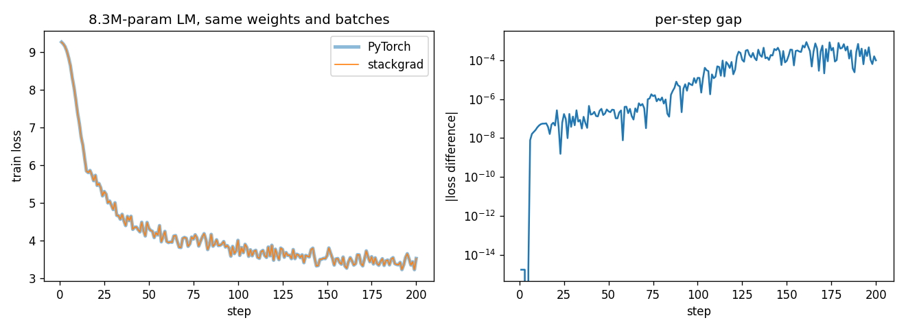

# stackgrad

[](https://github.com/samitmohan/minitorch/actions/workflows/ci.yml)


Qwen3-0.6B running on stackgrad's own engine and server on an M4, recorded in real time: the first token after
0.09 s, then 25.2 tokens per second.

A deep learning framework written from scratch, and the stack on top of it: from a single derivative to a server that
answers questions from Wikipedia and runs a tool-using agent. Reverse-mode autodiff with every gradient in one file
(`stackgrad/mlops.py`), three array backends (NumPy, Apple's GPU through MLX, NVIDIA's through CuPy), attention kernels
in Metal and Triton, a BPE tokenizer, a language model trained from nothing, Qwen3-0.6B loaded and served behind an
OpenAI-style endpoint, LoRA and GRPO fine-tuning, and retrieval-augmented generation and an agent on that server.
PyTorch, tiktoken, and transformers appear only in the tests, as the references each piece is checked against.

The write-up is [Modern AI: Autograd to Agents](https://samitmohan.in/blog/minitorch), one post in paper form that
explains each piece from first principles and ends each section on a measured number.



stackgrad and PyTorch train the same 8.3M-parameter model from the same weights on the same batches, in float64. At
step 1 their losses differ by 1.8e-15 (`bench/m1_parity.py --float64`).

## Results

Every number comes from a file the named script writes.

| | Result | Source |
|---|---|---|
| Size | the framework is 3,350 lines of Python (10,945 for the whole repository, tests and write-up included) | `scripts/lines.py` |
| Gradients | a model trained beside PyTorch from the same weights differs from it by 1.8e-15 in loss at the first step (float64) | `bench/m1_parity.py` |
| Training | a 22.7M-parameter model trains on TinyStories (327.7M tokens) to a validation loss of 1.399 in 71 minutes on one RTX 3090, at 23.9% MFU | `train_gpt.py` |
| A real model | Qwen3-0.6B's logits match Hugging Face's to 5.1e-5 in float32, and greedy decoding reproduces its first 24 tokens | `tests/qwen3.py` |
| Serving | 8 chats at once decode 128.4 tokens per second in total on an M4, 6.0x one forward pass per chat (21.4), and in float32 every batched reply matches its one-at-a-time reply token for token | `bench/serve_batch.py` |
| Retrieval | on SQuAD v1.1, the source paragraph is among the top three 91.5% of the time, and 55% of answers then contain the reference | `apps/rag.py` |

Also measured: at the training shape, where each attention head is 32 numbers wide and MLX has no fused kernel, the
Metal attention kernel runs 6.7x faster than MLX; at Qwen3's 128-wide heads, MLX's fused kernel runs 2.6x faster than
stackgrad's (`bench/flash_attention.py`). FlashAttention-2 in Triton runs forward and backward 8.5x faster than the
composed version on the RTX 3090 (`bench/flash_attention_cuda.py`).

What did not work, on 250 GSM8K problems (greedy, thinking off, 320 new tokens), against the released model's 152:

| Attempt | Solved | Paired sign test |
|---|---|---|
| LoRA fine-tuning on GSM8K's solutions | 123 | p = 0.0011 |
| GRPO, reward requiring a finished reply | 139 | p = 0.13 |
| A calculator tool, asked for in the prompt | 42 | p < 0.0001 |

(`bench/gsm8k.py`, `bench/gsm8k_compare.py`)

## Try it

```bash
git clone https://github.com/samitmohan/minitorch.git
cd minitorch
uv sync --extra metal --extra serve        # Apple silicon; NVIDIA: uv sync --extra cuda --no-dev

uv run python test_grads.py                 # every gradient against finite differences
uv run python tests/parity.py               # every op and layer against PyTorch
```

Chat with Qwen3-0.6B running on stackgrad, through the OpenAI-style endpoint. The first request loads the weights (23 s
on an M4, reply included); `"stream": true` returns server-sent events the way OpenAI's API does.

```bash
uv run hf download Qwen/Qwen3-0.6B --local-dir data/Qwen3-0.6B
uv run uvicorn stackgrad.serve.api:app --port 8000

# in another terminal
curl localhost:8000/v1/chat/completions -H 'Content-Type: application/json' \
  -d '{"messages": [{"role": "user", "content": "What is 17 times 23? Answer briefly."}], "temperature": 0}'
# "content": "17 × 23 = 391."
```

## Layout

```
stackgrad/        the framework: tensor.py and mlops.py (autograd), backend/ (NumPy, MLX, CuPy, Metal and Triton
                  kernels), layers, optimizers, attention, gpt.py, qwen3.py, tokenizer.py, lora.py, quant.py, serve/
apps/             rag.py and agent.py, clients of the server
train_*.py        TinyStories pretraining, LoRA, GRPO
examples/         GPT-2 and Stable Diffusion v1.5, one file each, in the style of tinygrad's examples
tests/            each piece against its reference (PyTorch, transformers, diffusers, finite differences)
bench/, scripts/  the measurements; results land in bench/results/
ui/               the write-up with live figures: React, reading bench/results/ and runs/ through the server
```

## Reproduce

```bash
uv run python scripts/tinystories.py download   # then: train, encode (the data and the 10k BPE, once)
uv run python train_gpt.py --run smoke --steps 300 --d-model 128 --layers 2 --heads 4 --d-ff 384
uv run python scripts/lines.py              # the size row above

cd ui && npm install && npm run build && cd ..
uv run uvicorn stackgrad.serve.api:app --port 8000   # the write-up with live figures, at http://localhost:8000

uv run --extra docs mkdocs serve            # the study plan (docs/guide.md) and the API reference
```

### Every number in the write-up

Each command writes the file its result is read from (`bench/results/`, `runs/`).

```bash
uv run python test_grads.py                    # gradient checks against finite differences
uv run python bench/m1_parity.py --float64     # training beside PyTorch (m1_parity_f64.json)
uv run python bench/lazy.py                    # lazy against eager execution (lazy.json)
uv run python scripts/tinystories.py train     # the tokenizer's training and encoding numbers
uv run python tests/backends.py --device metal # backends against NumPy (backends_metal.json)
uv run python bench/backend_overhead.py        # launch cost, matmul throughput, one training step per device
uv run python bench/flash_attention.py         # the Metal attention kernels against MLX
uv run python bench/profile_step.py --device metal  # where a training step's time goes (profile_metal.json)
uv run python bench/mixed_precision.py --device metal  # mixed precision (mixed_precision_metal.json)
uv run python bench/checkpointing.py --device metal    # activation checkpointing (checkpointing_metal.json)
uv run python scripts/scaling.py fit               # the IsoFLOP fit, from the grid below
uv run python tests/serve.py                   # the scheduler under load (serve_cpu.json)
uv run python tests/qwen3.py                   # Qwen3-0.6B against Hugging Face
uv run python tests/gpt2.py                    # GPT-2 against transformers
uv run python bench/serve_batch.py             # batched serving (serve_batch_metal.json)
uv run python bench/quant.py                   # quantization (quant.json)
uv run python bench/speculative.py             # speculative decoding (speculative_metal.json)
uv run python apps/rag.py                      # retrieval on SQuAD, with the server running
uv run python apps/agent.py                    # the calculator agent, with the server running
uv run python tests/stable_diffusion.py        # Stable Diffusion's networks against diffusers
uv run python bench/stable_diffusion.py        # Stable Diffusion's image beside diffusers'
uv run python bench/gsm8k.py                   # GSM8K accuracy before training

# on an NVIDIA GPU
uv run --no-dev python tests/backends.py --device cuda      # backends_cuda.json
CUPY_TF32=1 uv run --no-dev python scripts/scaling.py run --device cuda   # the scaling-law grid
CUPY_TF32=1 uv run --no-dev python train_gpt.py --run abl_baseline --device cuda --steps 10000 --warmup 500
    # the variants add --norm post, --norm none, --no-rope, or --ffn silu --d-ff 2048; then scripts/ablations.py (ablations.json)
CUPY_TF32=1 uv run --no-dev python bench/mixed_precision.py --device cuda  # mixed_precision_cuda.json
CUPY_TF32=1 uv run --no-dev python bench/checkpointing.py --device cuda --settings off:1,off:2,off:4,off:8,on:1,on:2,on:4,on:8  # checkpointing_cuda.json
CUPY_TF32=1 uv run --no-dev python bench/flash_attention_cuda.py         # flash_attention_cuda.json
CUPY_TF32=1 uv run --no-dev python bench/profile_step.py --device cuda    # profile_cuda.json
CUPY_TF32=1 uv run --no-dev python train_gpt.py --run tinystories --device cuda
CUPY_TF32=1 uv run --no-dev python train_lora.py --run lora_gsm8k --device cuda
CUPY_TF32=1 uv run --no-dev python bench/rollout.py --device cuda          # rollout_cuda.json
CUPY_TF32=1 uv run --no-dev python train_grpo.py --run grpo_gsm8k --device cuda --steps 200
CUPY_TF32=1 uv run --no-dev python train_grpo.py --run grpo_no_stop --device cuda --reward answer --steps 140
uv run python bench/gsm8k.py --adapter runs/lora_gsm8k/adapter.npz   # GSM8K after LoRA
uv run python bench/gsm8k.py --adapter runs/grpo_no_stop/adapter.npz  # after GRPO, reward ignores stopping
uv run python bench/gsm8k.py --adapter runs/grpo_gsm8k/adapter.npz   # after GRPO, reward requires stopping
uv run python bench/gsm8k_compare.py gsm8k_base gsm8k_agent          # the calculator's problem-by-problem split
uv run python bench/gsm8k_compare.py gsm8k_base gsm8k_grpo_gsm8k     # GRPO's split and sign test
uv run python bench/gsm8k_compare.py gsm8k_base gsm8k_lora_gsm8k     # LoRA's split and sign test
```

[SPEC.md](SPEC.md) holds the plan and the decisions behind it.

## License

MIT, see [LICENSE](LICENSE).
