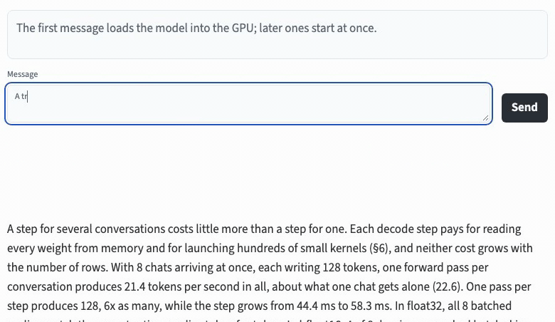
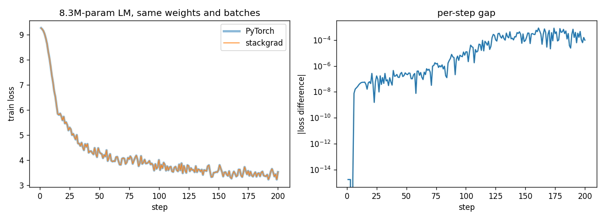

# stackgrad Showcase

Things stackgrad runs. Every number below comes from a file the named script writes, in `bench/results/` or `runs/`.

## Qwen3-0.6B chat



Qwen3-0.6B on stackgrad's own engine and server on an M4, recorded in real time: the first token after 0.09 s, then 25.2
tokens per second. Its logits match Hugging Face's to 5.1e-5 in float32, and greedy decoding reproduces its first 24
tokens (`tests/qwen3.py`). Eight chats at once decode 128.4 tokens per second in total, 6.0x one forward pass per chat
(`bench/serve_batch.py`).

```sh
uv sync --extra metal --extra serve
uv run hf download Qwen/Qwen3-0.6B --local-dir data/Qwen3-0.6B
uv run uvicorn stackgrad.serve.api:app --port 8000
curl localhost:8000/v1/chat/completions -H 'Content-Type: application/json' \
  -d '{"messages": [{"role": "user", "content": "What is 17 times 23? Answer briefly."}], "temperature": 0}'
```

## Training a language model

A 22.7M-parameter model trains on TinyStories (327.7M tokens) to a validation loss of 1.399 in 71 minutes on one RTX
3090, at 23.9% MFU.

```sh
uv run python scripts/tinystories.py download   # then: train, encode
CUPY_TF32=1 uv run --no-dev python train_gpt.py --run tinystories --device cuda
```

## Training beside PyTorch



stackgrad and PyTorch train the same 8.3M-parameter model from the same weights on the same batches, in float64. At step
1 their losses differ by 1.8e-15.

```sh
uv run python bench/m1_parity.py --float64
```

## Stable Diffusion


Stable Diffusion v1.5 in one file, like tinygrad's: CLIP's text encoder, the UNet stepping through DDIM, and the VAE
decoder. `tests/stable_diffusion.py` checks each network against diffusers.

```sh
uv run python -c 'from huggingface_hub import snapshot_download; snapshot_download("stable-diffusion-v1-5/stable-diffusion-v1-5", local_dir="data/sd15", allow_patterns=["tokenizer/*", "scheduler/*", "*/config.json", "*/*.fp16.safetensors"])'
uv run python examples/stable_diffusion.py --device metal --prompt "a watercolor of a lighthouse at dusk"
```

## GPT-2

OpenAI's 124M-parameter model, one file. `tests/gpt2.py` checks it against transformers.

```sh
uv run python -c 'from huggingface_hub import snapshot_download; snapshot_download("openai-community/gpt2", local_dir="data/gpt2")'
uv run python examples/gpt2.py --device metal --prompt "The meaning of life is"
```

## Retrieval and an agent

With the server running, Qwen3-Embedding-0.6B on stackgrad finds the SQuAD v1.1 paragraph a question came from among
its top three 91.5% of the time, and 55% of answers then contain the reference (`apps/rag.py`). `apps/agent.py` gives
the model a calculator tool for GSM8K.

## Attention kernels

At the training shape, where each head is 32 numbers wide and MLX has no fused kernel, the Metal attention kernel runs
6.7x faster than MLX. At Qwen3's 128-wide heads, MLX's fused kernel runs 2.6x faster than stackgrad's
(`bench/flash_attention.py`). FlashAttention-2 in Triton runs forward and backward 8.5x faster than the composed version
on the RTX 3090 (`bench/flash_attention_cuda.py`).

## What did not work

On 250 GSM8K problems (greedy, thinking off, 320 new tokens), the released model solves 152.

| Attempt | Solved | Paired sign test |
|---|---|---|
| LoRA fine-tuning on GSM8K's solutions | 123 | p = 0.0011 |
| GRPO, reward requiring a finished reply | 139 | p = 0.13 |
| A calculator tool, asked for in the prompt | 42 | p < 0.0001 |

(`bench/gsm8k.py`, `bench/gsm8k_compare.py`)
